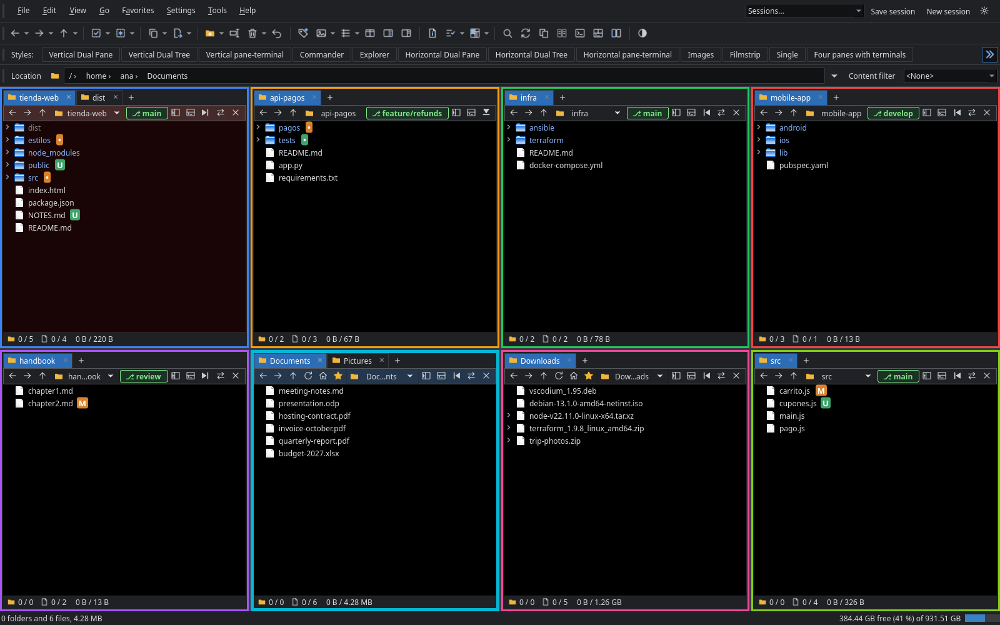
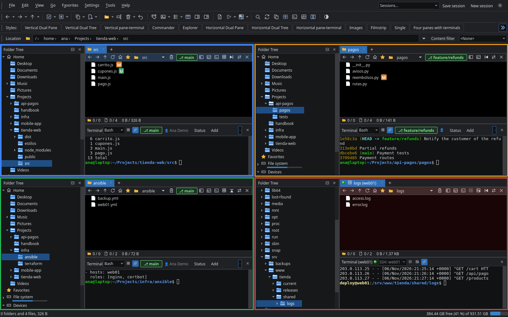
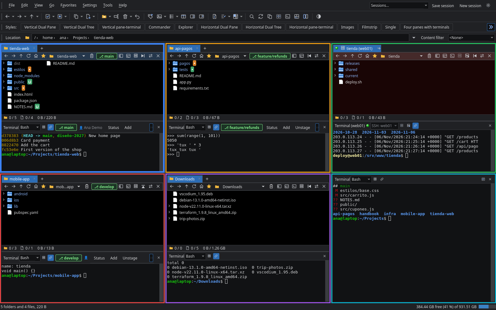
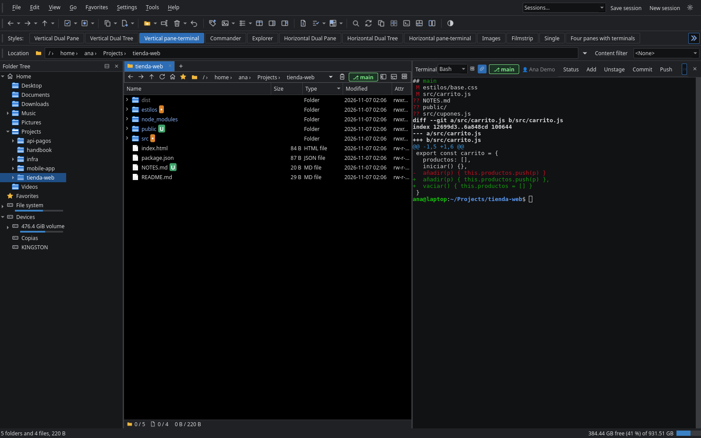
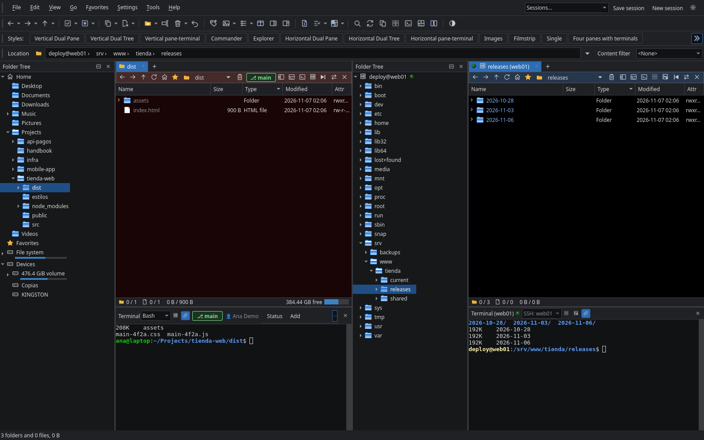
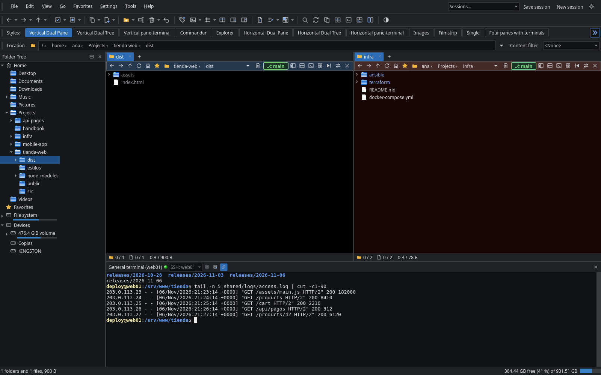

# Directory Commander ~~Plus Plus~~ Tux Tux

[Español](README.md) | **English**

A **multi-pane file manager with built-in terminals and git**, for **Linux (KDE and GNOME)** and **Windows**. Written in Python with Qt 6 (PySide6).


## Multi-pane, terminals and git

### Up to eight panes

- From one to eight panes, side by side, one above the other or in a grid, each with its own tabs
- Each pane can show or hide its own folder tree from the button on its bar, just like its terminal
- With more than two panes, each one goes with its terminal and its tree inside a frame of its own color, thicker for the active pane and, if you like, the others dimmed. It is shown and hidden with its toolbar button; from how many panes, the thickness, the dimming and the colors are chosen in Preferences
- Right-clicking an empty area splits a pane, with a new one below or to the right in the same folder, and closes it when it's no longer needed
- Styles to change the layout with one click, which you can edit or create yourself: see [Styles](#styles-one-layout-for-each-task)
- Named sessions that save panes, tabs and terminals. They are loaded, saved and started at the top right, and managed in Preferences → Sessions





### A terminal in each pane

- One terminal per pane, below it or to its right, plus a general one. They are real consoles: interactive programs such as `python`, `ssh` or `vim` work
- Each terminal follows its pane: when you change folder it types the `cd` for you, unless a program is running or you have started typing a command; in that case it waits until you finish. A button on its bar turns this on or off
- Each one can use its own shell, without leaving the folder it's in. On Windows, PowerShell, `cmd`, Git Bash, Cygwin, MSYS2, WSL or another program; on Linux, `bash`, `zsh`, `fish` and any others you have installed. The default is chosen in Preferences → General
- A pane's terminal opens with its button or `Ctrl+Shift+O`, and the general one with the toolbar button or `Ctrl+Shift+G`. Hiding them doesn't end what's running
- A pane can show only its terminal, filling its whole space, from the button on its bar or the right-click menu. It is never the source or the destination, and its terminal follows nobody unless you ask it to, and then it goes with the active pane. Its bar has a button to see the files again, in the folder the terminal is in, and an X that closes the pane. At least one pane with files always remains
- Dropping files on a terminal types their paths, quoted, without running anything
- The «Vertical pane-terminal» and «Horizontal pane-terminal» styles put a terminal in place of the second pane. In Preferences you can also make the general terminal take the whole width of the window when panes are side by side



### Built-in git

- Each terminal whose folder is a repository shows the active branch and the user commits will be signed with, and lets you switch branch or create one. The branch also appears on each pane's bar
- Buttons for `status`, `add`, `unstage`, `commit`, `push`, `pull`, `fetch`, `diff` and `log`, written in that same terminal
- `add`, `unstage` and `commit` open a window with the files and checkboxes, and show the command being built before sending it
- The command of each button can be changed and others can be added, in Preferences → Button bars. The rest is set in Preferences → Git integration




### Remote panes over SFTP and terminals over SSH

- Any pane can show a folder on a server: with the button on its bar, the right-click menu or File → Remote pane (SFTP)…, choose a saved profile or type a new connection. Its tab carries a server icon, its IP in brackets and a green light that blinks while the connection is alive and goes away if it is lost; that pane's folder tree shows it next to the server, and a terminal connected over SSH, on its bar. Its bar has a button to disconnect it, which takes it back to where it was. While it is connected, the connect button is disabled
- You browse it like a local folder, and copy and move between a remote pane and a local one both ways, also by dragging. You can create folders and files, rename and delete; a server has no trash, so deleting is always permanent and always confirmed
- The terminal of a remote pane opens on the server, over the same connection, follows its pane like the others and shows the IP on its bar. Its folder tree also shows the server's folders
- Any terminal, also the general one or that of a local pane, can open on a server over SSH with the connect button on its bar, which offers the profiles and a new connection. While connected, its list of shells shows the profile and cannot be changed; the disconnect button takes it back to the local shell
- SSH/SFTP profiles store server, port, user, password or key passphrase, private key or SSH agent, and start folder; they are managed in Preferences → SSH/SFTP, also reached from Settings → SSH/SFTP profiles…. When creating or editing one, «Test connection» checks the details without saving anything. The password can be given when creating the profile, and is not asked again. It goes to the system keyring (KWallet or GNOME Keyring on Linux, Credential Manager on Windows), never to the settings
- Sessions save remote tabs and, when loaded, connect them again with their profiles
- If the server stops answering, the window does not wait: after 20 seconds it says the connection was lost, and it reconnects when another folder is opened
- Quitting with SSH/SFTP connections open warns that they will be closed and asks to confirm, even if confirming on quit is turned off in the preferences
- The first time you connect to a server its fingerprint is shown and you are asked whether to trust it; accepting adds it to `~/.ssh/known_hosts`. If the key of a known server changes, it does not connect
- In Preferences → SSH/SFTP you choose whether the server's files open with their program (they are downloaded to a temporary folder and, when a change is saved, it is uploaded asking first or without asking, as chosen; if meanwhile the file changed on the server, you are always asked, so that change is not lost. A Markdown file from the server opens in the program's editor) and whether their preview and thumbnails are shown, up to a size





## Styles: one layout for each task

A style is a way of arranging the window: panes, folder trees, viewer, metadata, view and terminals. You switch between them with one click on the styles bar.

**The ones that come with the program are just a starting point: you can edit, duplicate, rename and delete them, and create your own.** Do it in Preferences → Styles or with the «New style…» button at the end of the bar. The editor shows a diagram of how the window will look, and you choose which styles appear on the bar and in what order.

| | |
|---|---|
| **Commander**: the classic two panes, with several tabs in each<br>[](docs/capturas/en/comandante.png) | **Vertical Dual Tree**: a folder tree for each pane, here in the light theme<br>[](docs/capturas/en/doble-arbol.png) |
| **Vertical pane-terminal**: a pane and its terminal side by side, with git<br>[](docs/capturas/en/git.png) | **Images**: thumbnails and a viewer on the side<br>[](docs/capturas/en/imagenes.png) |
| **Filmstrip**: a large viewer above a strip of images<br>[](docs/capturas/en/tira.png) | **A style of your own**: two panes, viewer and metadata<br>[](docs/capturas/en/estilo-propio.png) |

The four-pane layout at the top of this page is a custom style too. This is the editor, with the custom style above open:


## Status: version 0.1

This is a first working version. Developed for personal use.

## What else it includes

- Interface with menu, toolbar, styles row, «Location» bar, tree and a bar of its own in each pane
- Dark, light or desktop-matching theme, with its own icons and a different background for source and destination
- Compare two files, from one pane or two: whether they are identical, the differences of a text with diff, two images side by side with what differs in red, or an external comparison tool among those installed (Kompare, Meld, KDiff3, WinMerge…). Set in Preferences → Compare files
- System file manager, reversible, in Preferences → File manager: on Windows it replaces Explorer for folders on disk, with exceptions and Win+E, and on Linux it uses `xdg-mime`. It can also be undone with `directory-commander-tux-tux --restore-file-manager`
- Viewer and metadata with a button each; Preferences → General sets which one goes on top when both are shown
- The viewer highlights code in hundreds of languages (with Pygments), shows Markdown formatted or as code, and JSON sorted and highlighted, as an expandable tree (with `{ }`, `[ ]` and «key : value», like web JSON viewers) or as it is. A JSON file also opens in its own window, with search by key or value and copying the value or its path (`pages[0].nodes[1].type`)
- Markdown editor with a split view: the text on the left and how it looks on the right, live, with buttons for bold, italic, code, links, headings, lists and quotes. Markdown files open in it (or with the system application, in Preferences → General), and also with «Edit» in the viewer or «Edit Markdown» in the right-click menu. It saves in UTF-8 with the file's own line endings
- Disk usage (Tools, or right-click on a folder): its folders and files from largest to smallest and a treemap, one rectangle per file, sized by its size and colored by its type. What you pick in one is marked in the other, a double click on the map goes into a folder, and «Show in the pane» takes you there. A double click on a file in the list opens it with its program. From the map or the list (also with right-click) it can be sent to the trash (Del) or deleted without the trash (Shift+Del), and what is left is recalculated without analyzing again. It doesn't enter other disks mounted inside and counts hard links once
- Git marks in the list: M modified, A added, U untracked, R renamed, C conflicted; a folder with changes inside gets a dot, and what git ignores looks dimmer. Hovering a mark tells what it means. They are turned on in Preferences → Git integration
- Details, list, icons, tiles, thumbnails and filmstrip views
  - In details, every column can be widened by dragging its edge, the name too, and the widths are remembered. Until it is changed by hand, the name takes the free space; right-clicking the header fits it to the pane again or fits each column to its contents
  - In list, each column is as wide as its longest name, up to a maximum (50 characters by default, configurable in Preferences → General, or unlimited). A longer name is cut in the middle with «…» and shown in full when hovering it
  - The thumbnail size is chosen in Preferences → General, from 64 to 256 pixels
  - Videos show four frames spread along the video and their duration, or a single frame, or their icon (Preferences → General). FFmpeg extracts them in the background, about a second per video, and they are remembered while the program is open
  - Folders show their first images inside, up to four (can be turned off)
- AI-generated images and videos: a P mark if their metadata carry the prompt and a W mark if they carry the workflow, in every view: on the thumbnail or large icon, and after the name in list and details. They are hidden by default: the «AI marks» toolbar button (or View) shows and hides them, and Preferences → General chooses whether both or only one are shown. The tooltip and the hover card say which program and which model generated it, and the metadata panel shows the program, the whole prompt, the negative prompt, the model (in ComfyUI, the checkpoint loaded by the node connected to the sampler's «model» input, through the LoRAs, which are also shown), the steps, the seed and whether it carries the workflow, with its nodes. ComfyUI (PNG, WebP and video), Automatic1111, Forge, Fooocus, SwarmUI, InvokeAI, NovelAI and Midjourney are recognized
- Expandable folders within the list, folders always first and, by default, sorted by type (chosen in Preferences → Views and thumbnails; sorting by name is natural: «photo2» before «photo10»), quick filter, content filter by several types at once and flat view
- Each folder remembers its view and sort order (can be turned off in Preferences → General). A folder with nothing remembered keeps the tab's view, and two tabs can show the same folder differently: the last choice is remembered
- Status per pane: selection and totals, bytes and disk meter
- Copy, move and delete in the background, with progress, cancellation, collision detection and undo. Optionally, each copy is read back from disk and compared with the original (BLAKE2b): if they differ, it is discarded and, when moving, the original is kept (Preferences → General, or «Copy to destination and check the copy» on the Copy button)
- Image viewer in its own window, metadata panel, attributes and links
- Convert, rotate and resize images; split and join files; copy only what's newest
- Movable bars: drag them by their handle to another row, another edge or next to another bar, and the position is remembered. They can also be locked
- Card when resting the mouse on a file: thumbnail, dimensions, duration, codecs, tags and cover
- Double-click the tab bar to open a new tab
- Select by clicking the name; clicking elsewhere clears the selection. To go back to full-row selection: `Set FULLROWSELECT=Toggle` or the View menu
- On Windows, the path starts at «This PC», which shows drives grouped by type (SSD, HDD, other, removable, optical and network), with capacity, free space, usage bar and file system
- Folder tree with sections: Home, Favorites and the drives (the file system on Linux). On Linux, also Devices, like the desktop's places panel: the disks and partitions that can be opened, without the boot, Windows recovery or swap ones. Mounted ones carry a bar with the used space, like «File system», and their tooltip shows the device, the file system, where it is mounted, the size, the used and the free space; clicking one that is not mounted mounts it and opens it. It mounts like the desktop does, with UDisks over D-Bus: if the system requires the password, it asks for it in its own window. Its menu can unmount it and safely remove a USB drive. What is plugged in or mounted from another program appears by itself
- Opening with one click, optional (Preferences → General): one click opens the file or folder, and hovering turns its icon into a + that adds it to the selection (− removes it); on thumbnails the + goes in their corner. Ctrl, Shift and the selection rectangle still work the same. With the viewer or the metadata open, they show the file under the mouse, except videos and audio, which would start playing; leaving it goes back to the selection
- Quitting asks for confirmation; it can be turned off in Preferences → General
- General status bar at the bottom of the window: the file under the mouse or the selection in the active pane, the free space with its percentage and the disk size, and the notices. It also shows, for the file under the mouse or the only one selected, its date and, for an image, its dimensions; for a video, its dimensions and duration; for audio, its duration; whether a filter is active or hidden files are shown, and the progress of running copies and moves. While it's shown, the free space goes only there, except in a pane with a folder on another disk, which shows its own (chosen in Preferences → General: only those, all or none). It can be removed in Preferences → General; without it, notices go to the status row of the active pane and the free space to each pane's
- Files open with the system's default application; on Linux, with `xdg-open`, without the desktop window that asks which application to use
- Right-click a name: menu for that file or folder. Right-click anywhere else: menu for the open folder, without changing the selection. Also with the menu key or `Shift+F10`
- Saved layouts and tab groups, favorites bar, recent and frequent folders, navigation lock and selection checkboxes
- System trash and clipboard compatible with Explorer, Dolphin and Nautilus
- Drag files and folders between folders, panes and the tree: on the same drive it moves and to another it copies (Shift forces move and Ctrl copy). Dragging with the right button asks what to do: copy, move, create a shortcut or options from other programs, as in any file explorer. Dropping a folder on the tab bar opens it in a new tab
- Progress window when copying or moving: current item, total, times, speed graph, skip, pause and unattended mode
- Batch rename with preview: text, wildcards, regex, `[#]` numbering, case and presets
- ZIP, TAR and variants: they open with the system program or, depending on preferences, are browsed like folders (read-only). ZIP extraction and creation
- Search files by name, text, type, date, time and size, in several folders, subfolders and archives, with exclusions. It has advanced AND/OR rules, templates and history. It appears in a separate window, in one or two columns, or at the bottom of the main window, and results open in a new tab, like any other folder
- Synchronize two folders and find duplicates
- Information when hovering over files and folders
- On Windows, context menus include options from the system and other installed programs. Menus can be sorted and trimmed in the preferences
- «Open with» in a file's menu: on Windows, the system's; on Linux, the programs installed for that file type
- Folder sizes, hashes (MD5, SHA-1, SHA-256, SHA-512, BLAKE2b) and image and text viewer (images can open in the internal viewer or in the system application)
- Cropping in the image viewer: select a part with the mouse and save it as a new image
- Video and audio playback in the viewer, with position bar, volume and optional autoplay
- Video viewer in its own window: the same controls, frame by frame and saving a frame as PNG (videos can open in it or in the system application, and «Open with» always offers the other option)
- Export and import favorites and settings as JSON files
- Customizable bars: in Preferences, or by right-clicking a bar → Customize…, choose which buttons each one shows and in what order, including the styles bar, which ends with a «New style…» button
- Favorites with branches: a button in each pane to add the folder (`Ctrl+D`), choosing name and branch, or open any favorite. They are edited in Preferences → Frequent paths, where you also set recent folders, history and smart favorites, the most used folders according to the points each action gives
- Metadata panel with its own button: the data is read by [ExifTool](https://exiftool.org/), which must be installed separately (12.24 or later) and set in Preferences → General if it isn't on the PATH. Without it, only basic file data is shown
- Languages: Spanish and English, and more can be added with a file, without touching the program ([how to translate it, in Spanish](docs/TRADUCIR.md))
- Pane colors are chosen from several combinations, or by creating your own, in Preferences → General
- Configurable tab bar: new-tab button and double-click, position on any side, sizes, `»` menu or several rows, labels and ways of closing

## Run from source

Requires Python 3.12 or later.

Windows:

```bash
python -m venv .venv
.venv\Scripts\python -m pip install -e .
.venv\Scripts\python -m directory_commander_tux_tux
```

Linux, installed for the current user with an entry in the KDE or GNOME menu:

```bash
sh packaging/linux/install.sh
```

## Installers and portable version

The packages for each version are published on the repository's releases page. If you build them yourself, they end up in `dist/`. They don't include ExifTool. PyInstaller doesn't cross-compile, so each one is built on its own system:

```bash
python -m pip install -e ".[dev]"
```

```bash
python packaging/build.py all
```

| System | Package | What it needs | How it's used |
|---|---|---|---|
| Windows | `…-windows-setup.exe` | [Inno Setup 6](https://jrsoftware.org/isinfo.php) | Installer. It doesn't ask for administrator rights and is uninstalled from Windows |
| Windows | `…-windows-portable.zip` | Nothing else | Unzip it into any folder or USB drive |
| Linux | `…_amd64.deb` | Nothing else | `sudo apt install ./file.deb` |
| Linux | `…-x86_64.AppImage` | [appimagetool](https://github.com/AppImage/appimagetool) | Make it executable and open it, without installing |
| Linux | `…-linux-portable.tar.gz` | Nothing else | Unpack it into any folder |

They can also be built one at a time with `exe`, `portable`, `installer` and `appimage`. When a `v*` tag is pushed to GitHub, the `.github/workflows/release.yml` workflow builds them all and publishes them.

### Portable version

The portable version keeps its settings in the `config` folder, next to the program, and leaves nothing in the user's settings. What turns it on is the `portable.txt` file inside it: if you delete it, the user's settings are used. It can't be the system's file manager, because it can be moved.

## Audio and video

MP4, MOV, M4A, MKV, WebM, AVI, MP3, FLAC and WAV data is read without any dependency. To see video frames (in the card and in thumbnails) and read other formats, such as OGG, FFmpeg is needed: it's looked for on the `PATH` or in the folder set in Settings → Preferences. Without FFmpeg, videos show their data with an icon instead of the frame.

## Favorites and settings as JSON

Favorites are exported and imported from the Favorites menu; importing adds them without duplicates.

Settings, from the Settings menu. When exporting you check the groups to take, and a file name with the date and time is proposed (`configuracion_2026-11-04_09-05.json`), which you can change; when importing, which of the file's groups to apply. What you check replaces what you had and applies immediately. The groups are appearance (including the width of the general terminal), bars, context menus, favorites, recent folders, behavior, viewer and player, layouts with tab groups, sessions and the tab settings, search, rename, Git integration and SSH/SFTP.

- **SSH/SFTP**: the profiles and, if checked, their servers' keys in `~/.ssh/known_hosts` and the saved passwords. Passwords go encrypted with a key (scrypt and AES-256-GCM), which is asked for when importing, or in plain text, with a warning. When imported they are saved in the system keyring. Missing server keys are added; if there is already another one for that server, the existing one is kept.
- **Across computers and systems**: the file records the source system and home folder. When importing, paths inside that folder (favorites, sessions, layouts, a profile's key…) move to this computer's home folder, also from Windows to Linux and back.

The open session, recent folders, the visits counted by smart favorites, window sizes and positions and the default file manager never travel: they belong to each computer. Neither do programs (the terminal shell and command, the FFmpeg and ExifTool folders, the git program and its commands, and the comparison tool): they would run on the other computer, and their paths depend on each system.

```json
{
  "format": "directory-commander-tux-tux-favorites",
  "version": 1,
  "favorites": [{ "label": "Photos", "path": "/home/ana/Photos" }]
}
```

Bar buttons can run programs with `Run`: only import settings you trust.

## Commands

Every button, menu and shortcut runs a text command, which can also be typed on the command line
(`Ctrl+Shift+P`). The toolbar is defined in `toolbar` inside `config.json`
(`%APPDATA%\DirectoryCommanderTuxTux` or `~/.config/directory-commander-tux-tux`).

Style names in commands are the internal ones, in Spanish, as in the `STYLE=` example below.

```text
Go UP | BACK | FORWARD | ROOT | HOME | REFRESH | TABNEW | TABCLOSE | SWAP | DEST | /desktop | /downloads | "path"
Go NEWTAB[=nofocus] FROMSEL | DRIVEBUTTONS | TABGROUPSAVE | TABGROUPLIST
Copy [MOVE] [HERE] [TO="path"] [AS] [DUPLICATE] [MAKELINK=softlink|hardlink] [CREATEFOLDER="name"]
Copy UPDATEALL | UPDATEEXISTING | ADDTOARCHIVE | ARCHIVE=single | EXTRACT
Delete [NORECYCLE] [QUIET]        Undo [REDO]
CreateFolder [NAME="{date|yyyy-MM-dd} {time|HH-mm-ss}"] [ZIP]      CreateFile [NAME="name"]
FileType NEW=.txt | NEWMENU | CONTEXTMENU
Rename [ADVANCED] [PRESET=name|!list]
Select ALL | NONE | INVERT | RESELECT | SIMILAR | PATTERN=*.jpg | TOCHECKS | FROMCHECKS
Select SOURCETODEST=in|notin[,noext] [DESELECTNOMATCH]      Select DESTTOSOURCE=in|notin
Set DUAL=Off|Vertical|Horizontal|Toggle  STYLE="Vertical doble panel"  CONTENTTYPE=images  DARKMODE=Toggle
Set VIEW=Details|List|SmallIcons|LargeIcons|Tiles|Thumbnails|FilmStrip  VIEW=Cycle,List,Details
Set SORTBY=name|size|type|modified|attr|sortlist  SORTREVERSE=On|Off  FRIENDLYDATES=off|today|normal
Set FLATVIEW=Toggle  HIDDEN=Toggle  TREE=Toggle  PANETREE=Toggle  TERMINALPANE=On|Off  PANEFRAMES=Toggle  VIEWPANE=Toggle  METAPANE=Toggle  TERMINAL=Toggle  GENERALTERMINAL=Toggle  CMDLINE=Toggle  FILTER=Show
Set SFTP=Menu|Off|"profile name"
Set NAVLOCK=Toggle  CHECKBOXMODE=Toggle  EXPANDABLEFOLDERS=Toggle  GRIDLINESH=Toggle  STATUSBAR=Toggle  STATE=Source|Dest
Set DELRECYCLEBIN=Toggle  DELRECYCLECONFIRM=Toggle  UTILITY=Find|Sync|Dupe|Jobs|Log|Off[,Toggle]
Set LOCKBARS=Toggle  HOVERINFO=Toggle
Image CONVERT[=png] [ROTATE=90] [WIDTH=n] [HEIGHT=n] [PRESERVEASPECTRATIO] [HERE] [REPLACE] [PRESERVEDATE] [ADDSUFFIX]
Show [SLIDESHOW] [FULLSCREEN]     SetAttr [MODIFIED=now]         Split      Join      Find      Play
Print FOLDER [TO=clip]            Recent [CLEAR]                 Close [PROGRAM=confirm]
Prefs [LAYOUTSAVE] [LAYOUTLIST] [LAYOUTEDIT] [EXPORT] [IMPORT] [SFTP]
Toolbar NAME="Favorites Bar" TOGGLE | LIST | RESETDEFAULTS
Clipboard COPY | CUT | PASTE | COPYNAMES[=nopaths]
GetSizes [HASH=sha256]            Archive        Extract        Properties
Compare FILES
Favorites ADD | IMPORT | EXPORT | MENU | EDIT | SMART                     CLI DOSPROMPT
Run program --option {filepath} {allfilepath} {sourcepath} {destpath}
https://address/to/open
```

A command with an argument it doesn't understand doesn't run: `Copy SENDMAIL` is rejected instead of
behaving like a normal `Copy`.

A button can have several lines. `@keydown:none`, `@keydown:shift` and similar choose which block runs depending on the keys pressed, and `@confirm:question` asks for confirmation.

`Run` doesn't use a shell: placeholders are replaced after splitting the arguments, so
a file name is never interpreted as part of the command.

## Main shortcuts

| Shortcut | Action | Shortcut | Action |
| --- | --- | --- | --- |
| `F2` / `Ctrl+F2` | Rename / advanced | `F6` / `Shift+F6` | Copy / move to destination |
| `F3` | Viewer | `F7` | New folder |
| `F4` / `Ctrl+L` | Type path | `F5` / `Ctrl+R` | Refresh |
| `Del` / `Shift+Del` | Trash / permanently | `Ctrl+Z` / `Ctrl+Y` | Undo / redo |
| `Ctrl+F` | Filter | `Ctrl+Shift+F` | Search files |
| `Ctrl+S` | Select by pattern | `Ctrl+D` | Add to favorites |
| `Ctrl+T` / `Ctrl+W` | Open / close tab | `Ctrl+1` to `Ctrl+6` | Change view |
| `Alt+←` / `Alt+→` / `Alt+↑` | Back / forward / up | `Backspace` | Up |
| `→` / `←` on a folder | Expand / collapse | `Ctrl+Alt+T` | Terminal in another window |
| `Ctrl+Shift+O` | Pane terminal | `Ctrl+Shift+G` | General terminal |

In the image viewer: `←` `→` change image, `+` `-` zoom, `0` fit, `1` actual size, `F` full screen, `S` slideshow and `Esc` close.

## License

[MIT](LICENSE). The program uses Qt for Python and, to play video and audio, FFmpeg, each with its own license (LGPL). The packages carry these and other third-party libraries: the list is in [THIRD_PARTY_NOTICES.md](THIRD_PARTY_NOTICES.md). [ExifTool](https://exiftool.org/) isn't part of the program: it's installed separately, with its own license.

## Development

```bash
python -m pytest tests -q
```

The real trash test is skipped by default, because it leaves a file there. To run it, set `DETUX_REAL_TRASH=1`.

`directory_commander_tux_tux/core` doesn't depend on Qt. `directory_commander_tux_tux/ui` contains the interface.
