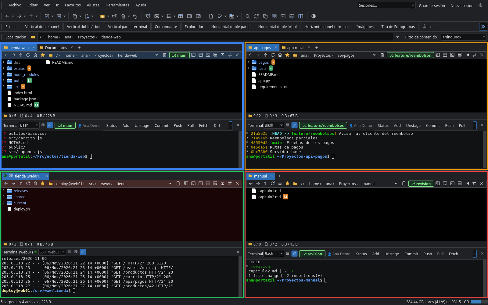
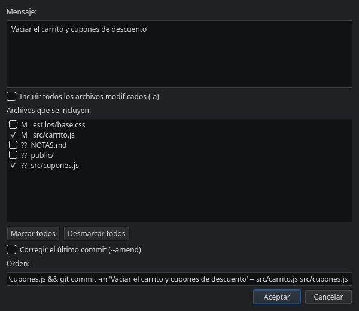
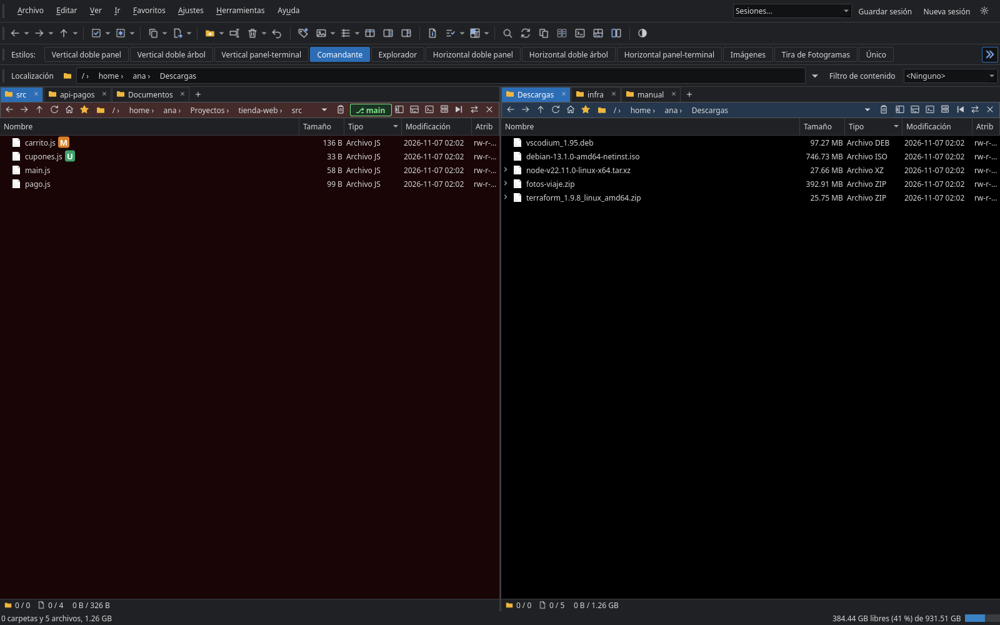
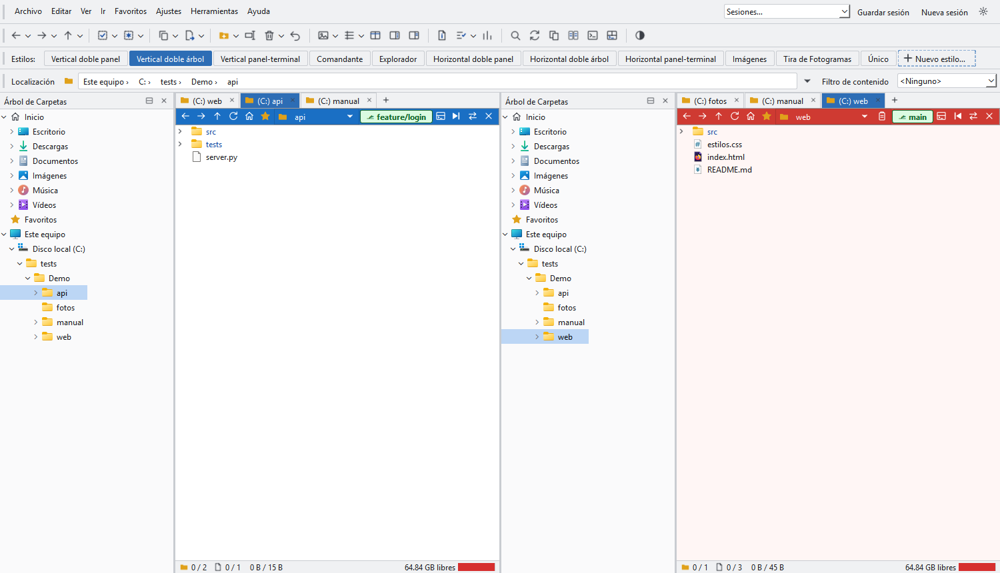
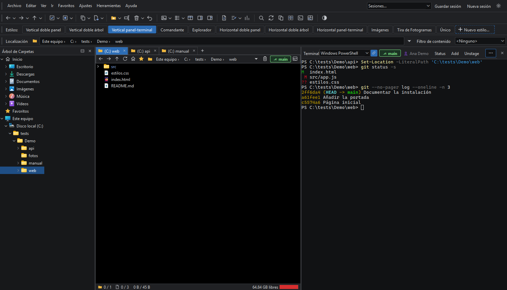
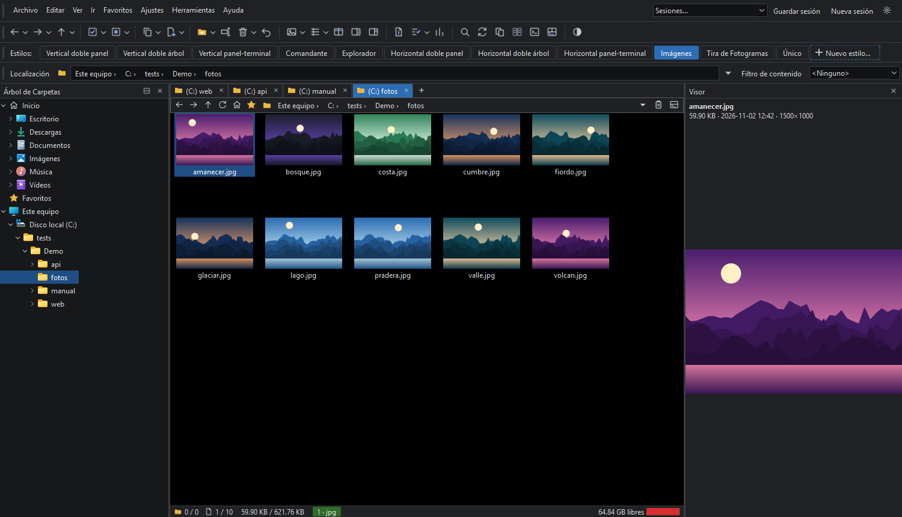
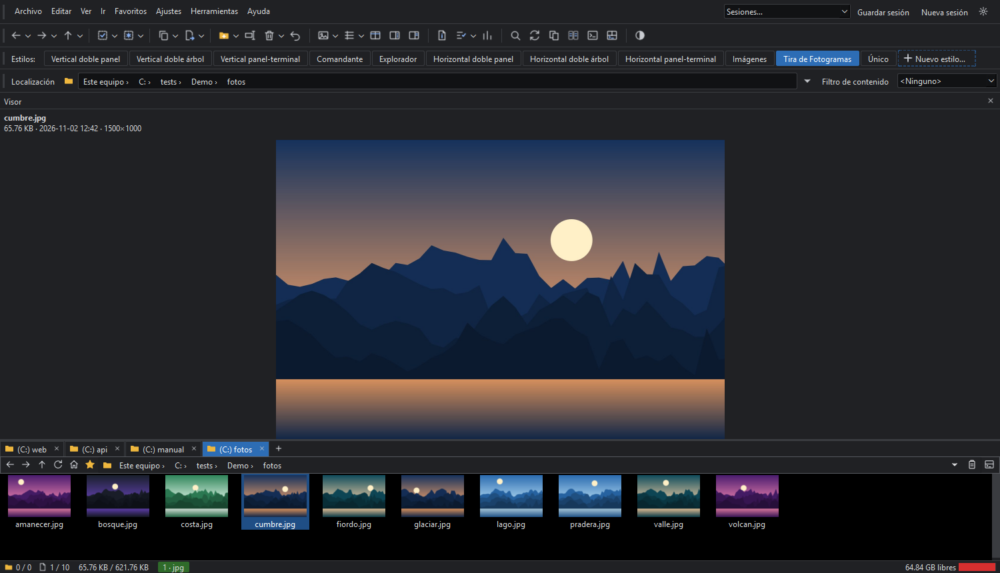
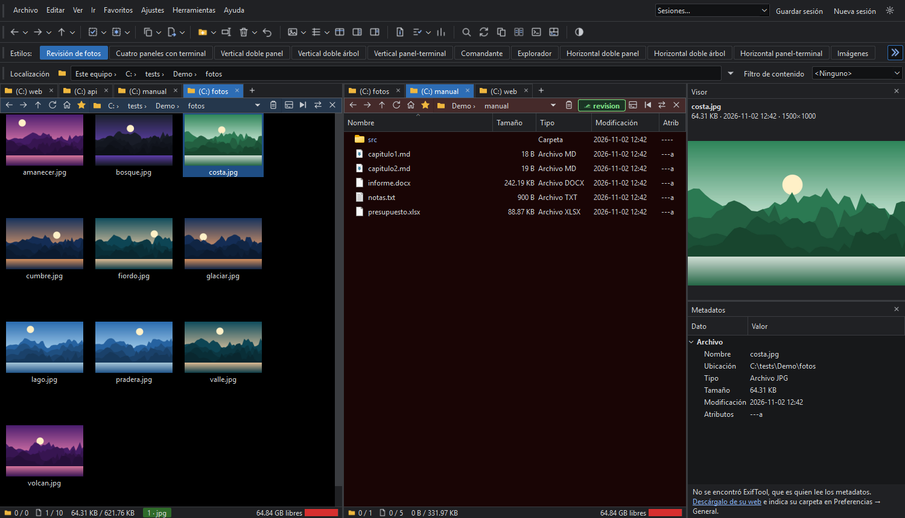
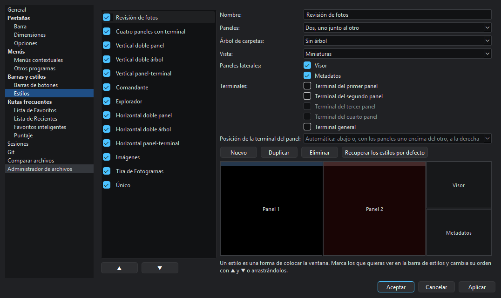

# Directory Commander ~~Plus Plus~~ Tux Tux

**Español** | [English](README.en.md)

Gestor de archivos **multipanel, con terminales integradas y git**, para **Linux (KDE y GNOME)** y **Windows**. Escrito en Python con Qt 6 (PySide6).



## Multipanel, terminales y git

### Hasta ocho paneles

- De uno a ocho paneles, uno junto al otro, uno encima del otro o en cuadrícula, cada uno con sus pestañas
- Cada panel puede mostrar u ocultar su propio árbol de carpetas, con el botón de su barra, igual que su terminal
- Con más de dos paneles, cada uno va con su terminal y su árbol dentro de un marco de su color, más grueso el del panel activo, y si quieres, los demás atenuados. Se muestra y oculta con su botón de la barra de herramientas; a partir de cuántos paneles, el grosor, la atenuación y los colores se eligen en Preferencias
- El clic derecho en una zona vacía divide un panel, con otro debajo o a la derecha en la misma carpeta, y lo cierra cuando ya no hace falta
- Estilos para cambiar de disposición con un clic, que puedes editar o crear tú: mira [Estilos](#estilos-una-disposición-para-cada-tarea)
- Sesiones con nombre que guardan paneles, pestañas y terminales. Arriba a la derecha se cargan, se guardan y se empieza una nueva; se administran en Preferencias → Sesiones

### Una terminal en cada panel

- Una terminal por panel, abajo o a la derecha, y una general. Son consolas de verdad: funcionan los programas interactivos, como `python`, `ssh` o `vim`
- Cada terminal sigue a su panel: al cambiar de carpeta escribe el `cd` por ti, salvo si hay un programa en marcha o has empezado a escribir una orden; en ese caso espera a que termines. Un botón de su barra activa o desactiva este seguimiento
- Cada una puede usar su propio intérprete, sin salir de la carpeta en la que está. En Windows, PowerShell, `cmd`, Git Bash, Cygwin, MSYS2, WSL u otro programa; en Linux, `bash`, `zsh`, `fish` y los demás que tengas instalados. El predeterminado se elige en Preferencias → General
- La de cada panel se abre con su botón o con `Ctrl+Shift+O`, y la general con el de la barra de herramientas o con `Ctrl+Shift+G`. Ocultarlas no termina lo que se esté ejecutando
- Los estilos «Vertical panel-terminal» y «Horizontal panel-terminal» ponen una terminal en lugar del segundo panel. En Preferencias también se puede hacer que, con los paneles en vertical, la general ocupe todo el ancho de la ventana

### Git integrado

- Cada terminal cuya carpeta sea un repositorio muestra la rama activa y el usuario con el que se firmarán los commits, y permite cambiar de rama o crear otra. La rama también se ve en la barra de cada panel
- Botones para `status`, `add`, `unstage`, `commit`, `push`, `pull`, `fetch`, `diff` y `log`, que se escriben en esa misma terminal
- `add`, `unstage` y `commit` abren una ventana con los archivos y casillas, y muestran la orden que se va armando antes de enviarla
- La orden de cada botón se puede cambiar y se pueden añadir otras, en Preferencias → Barras de botones. El resto se configura en Preferencias → Git



## Estilos: una disposición para cada tarea

Un estilo es una forma de colocar la ventana: paneles, árboles de carpetas, visor, metadatos, vista y terminales. Se cambia de uno a otro con un clic en la barra de estilos.

**Los que trae el programa son solo un punto de partida: se pueden editar, duplicar, renombrar y eliminar, y crear los tuyos.** Se hace en Preferencias → Estilos o con el botón «Nuevo estilo…» del final de la barra. El editor muestra un esquema de cómo quedará la ventana, y se elige qué estilos se ven en la barra y en qué orden.

| | |
|---|---|
| **Comandante**: los dos paneles clásicos, con varias pestañas en cada uno<br>[](docs/capturas/es/comandante.png) | **Vertical doble árbol**: un árbol de carpetas para cada panel, aquí en el tema claro<br>[](docs/capturas/es/doble-arbol.png) |
| **Vertical panel-terminal**: un panel y su terminal, uno junto al otro, con git<br>[](docs/capturas/es/panel-terminal.png) | **Imágenes**: miniaturas y un visor al lado<br>[](docs/capturas/es/imagenes.png) |
| **Tira de Fotogramas**: un visor grande sobre una tira de imágenes<br>[](docs/capturas/es/tira.png) | **Un estilo propio**: dos paneles, visor y metadatos<br>[](docs/capturas/es/estilo-propio.png) |

Los cuatro paneles del principio de esta página también son un estilo propio. Este es el editor, con el estilo propio de arriba abierto:



## Estado: versión 0.1

Es una primera versión funcional. Desarrollado para uso personal.


## Qué más incluye

- Interfaz con menú, barra de herramientas, fila de estilos, barra «Localización», árbol y barra propia en cada panel
- Tema oscuro, claro o según el escritorio, con iconos propios y fondo distinto para origen y destino
- Comparar dos archivos, de un panel o de dos: si son idénticos, las diferencias de un texto con diff, dos imágenes lado a lado con lo distinto en rojo o un comparador externo de los que haya instalados (Kompare, Meld, KDiff3, WinMerge…). Se configura en Preferencias → Comparar archivos
- Administrador de archivos del sistema, reversible, en Preferencias → Administrador de archivos: en Windows sustituye al Explorador para las carpetas del disco, con excepciones y Win+E, y en Linux usa `xdg-mime`. También se deshace con `directory-commander-tux-tux --restore-file-manager`
- Visor y metadatos con su botón cada uno; en Preferencias → General se elige cuál va arriba cuando se ven los dos
- Vistas de detalles, lista, iconos, mosaicos, miniaturas y tira de fotogramas
- Carpetas desplegables dentro de la lista, orden natural con carpetas primero, filtro rápido, filtro de contenido por varios tipos a la vez y vista plana
- Estado por panel: selección y totales, bytes y medidor de disco
- Copiar, mover y eliminar en segundo plano, con progreso, cancelación, detección de colisiones y deshacer
- Visor de imágenes en ventana propia, panel de metadatos, atributos y enlaces
- Convertir, girar y redimensionar imágenes; dividir y unir archivos; copiar solo lo más reciente
- Barras que se pueden mover: se arrastran por su asa a otra fila, a otro borde o junto a otra barra, y la posición se recuerda. También se pueden bloquear
- Tarjeta al dejar el ratón sobre un archivo: miniatura, dimensiones, duración, códecs, etiquetas y portada
- Doble clic en la barra de pestañas para abrir una nueva
- Se selecciona pulsando el nombre; pulsar fuera quita la selección. Para volver a la fila completa: `Set FULLROWSELECT=Toggle` o el menú Ver
- En Windows, la ruta empieza por «Este equipo», que muestra las unidades agrupadas por tipo (SSD, HDD, otras, extraíbles, ópticas y de red), con capacidad, espacio libre, barra de uso y sistema de archivos
- Árbol de carpetas con secciones: Inicio (Home en Linux), Favoritos y las unidades (el sistema de archivos en Linux)
- Clic derecho sobre un nombre: menú de ese archivo o carpeta. Clic derecho en cualquier otro sitio: menú de la carpeta abierta, sin cambiar la selección. También con la tecla de menú o `Mayús+F10`
- Diseños y grupos de pestañas guardados, barra de favoritos, carpetas recientes y frecuentes, bloqueo de navegación y casillas de selección
- Papelera del sistema y portapapeles compatible con Explorer, Dolphin y Nautilus
- Arrastrar archivos y carpetas entre carpetas, paneles y el árbol: en la misma unidad mueve y a otra copia (Mayús obliga a mover y Ctrl a copiar). Arrastrar con el botón derecho pregunta qué hacer: copiar, mover, crear un acceso directo o las opciones de otros programas, como en cualquier explorador. Soltar una carpeta en la barra de pestañas la abre en una pestaña nueva
- Ventana de progreso al copiar o mover: elemento actual, total, tiempos, gráfica de velocidad, omitir, pausar y modo desatendido
- Renombrado en lote con vista previa: texto, comodines, regex, numeración `[#]`, mayúsculas y presets
- ZIP, TAR y variantes: se abren con el programa del sistema o, según las preferencias, se navegan como carpetas (solo lectura). Extracción y creación de ZIP
- Buscar archivos por nombre, texto, tipo, fecha, hora y tamaño, en varias carpetas, subcarpetas y comprimidos, con exclusiones. Tiene reglas avanzadas Y/O, plantillas e historial. Se muestra en una ventana aparte, en una o dos columnas, o abajo en la ventana principal, y los resultados se abren en una pestaña nueva, como una carpeta más
- Sincronizar dos carpetas y localizar duplicados
- Información al pasar el ratón por archivos y carpetas
- En Windows, los menús contextuales incluyen las opciones del sistema y de otros programas instalados. Los menús se pueden ordenar y recortar en las preferencias
- «Abrir con» en el menú de un archivo: en Windows, el del sistema; en Linux, los programas instalados para ese tipo de archivo
- Tamaño de carpetas, hashes (MD5, SHA-1, SHA-256, SHA-512, BLAKE2b) y visor de imágenes y texto (las imágenes pueden abrirse en el visor interno o en la aplicación del sistema)
- Recorte en el visor de imágenes: se selecciona una parte con el ratón y se guarda como una imagen nueva
- Reproducción de vídeo y audio en el visor, con barra de posición, volumen y reproducción automática opcional
- Visor de vídeo en ventana propia: los mismos controles, fotograma a fotograma y guardar un fotograma como PNG (los vídeos pueden abrirse en él o en la aplicación del sistema, y «Abrir con» ofrece siempre la otra opción)
- Exportar e importar favoritos y configuración en archivos JSON
- Barras personalizables: en Preferencias, o con clic derecho en una barra → Personalizar…, se elige qué botones muestra cada una y en qué orden, también en la barra de estilos, que termina con un botón «Nuevo estilo…»
- Favoritos con ramas: botón en cada panel para añadir la carpeta (`Ctrl+D`), eligiendo nombre y rama, o abrir cualquier favorito. Se editan en Preferencias → Rutas frecuentes, donde también se configuran las carpetas recientes, el historial y los favoritos inteligentes, las carpetas más usadas según los puntos que da cada acción
- Panel de metadatos con su propio botón: los datos los lee [ExifTool](https://exiftool.org/), que hay que instalar aparte (12.24 o posterior) e indicar en Preferencias → General si no está en el PATH. Sin él, se ven solo los datos básicos del archivo
- Idiomas: español e inglés, y se pueden añadir más con un archivo, sin tocar el programa ([cómo traducirlo](docs/TRADUCIR.md))
- Los colores de los paneles se eligen entre varias combinaciones, o creando las tuyas, en Preferencias → General
- Barra de pestañas configurable: botón y doble clic de nueva pestaña, posición en cualquier lado, tamaños, menú `»` o varias filas, etiquetas y formas de cerrar

## Ejecutar desde el código

Requiere Python 3.12 o posterior.

Windows:

```bash
python -m venv .venv
.venv\Scripts\python -m pip install -e .
.venv\Scripts\python -m directory_commander_tux_tux
```

Linux, instalación para el usuario actual con entrada en el menú de KDE o GNOME:

```bash
sh packaging/linux/install.sh
```

## Instaladores y versión portable

Los paquetes de cada versión se publican en la página de versiones del repositorio. Para generarlos uno mismo, quedan en `dist/`. No incluyen ExifTool. PyInstaller no compila de forma cruzada, así que cada uno se genera en su sistema:

```bash
python -m pip install -e ".[dev]"
```

```bash
python packaging/build.py all
```

| Sistema | Paquete | Qué hace falta | Cómo se usa |
|---|---|---|---|
| Windows | `…-windows-setup.exe` | [Inno Setup 6](https://jrsoftware.org/isinfo.php) | Instalador. No pide permisos de administrador y se desinstala desde Windows |
| Windows | `…-windows-portable.zip` | Nada más | Se descomprime en cualquier carpeta o memoria USB |
| Linux | `…_amd64.deb` | Nada más | `sudo apt install ./archivo.deb` |
| Linux | `…-x86_64.AppImage` | [appimagetool](https://github.com/AppImage/appimagetool) | Se le dan permisos de ejecución y se abre, sin instalar |
| Linux | `…-linux-portable.tar.gz` | Nada más | Se descomprime en cualquier carpeta |

También se pueden generar por partes con `exe`, `portable`, `installer` y `appimage`. Al subir una etiqueta `v*` a GitHub, el flujo `.github/workflows/release.yml` genera todos y los publica.

### Versión portable

La versión portable guarda su configuración en la carpeta `config`, junto al programa, y no deja nada en la configuración del usuario. Lo que la activa es el archivo `portable.txt` que lleva dentro: si se borra, usa la del usuario. No puede ser el administrador de archivos del sistema, porque se puede mover de sitio.

## Audio y vídeo

Los datos de MP4, MOV, M4A, MKV, WebM, AVI, MP3, FLAC y WAV se leen sin ninguna dependencia. Para ver un fotograma de los vídeos y leer otros formatos, como OGG, hace falta FFmpeg: se busca en el `PATH` o en la carpeta indicada en Ajustes → Preferencias. Sin FFmpeg, los vídeos muestran sus datos con un icono en lugar del fotograma.

## Favoritos y configuración en JSON

Los favoritos se exportan e importan desde el menú Favoritos; al importar se añaden sin duplicar. La configuración, desde el menú Ajustes: tema, preferencias, barra de botones, estilos, diseños, grupos de pestañas, presets de renombrado y favoritos. Se aplica al momento.

La sesión, las carpetas recientes y las carpetas de FFmpeg y ExifTool no viajan en el archivo, porque son propias de cada equipo. Tampoco el programa de la terminal, las órdenes de git ni el comparador externo: importarlos haría que se ejecutase lo que eligió quien creó el archivo.

```json
{
  "format": "directory-commander-tux-tux-favorites",
  "version": 1,
  "favorites": [{ "label": "Fotos", "path": "/home/ana/Fotos" }]
}
```

Los botones de una barra pueden ejecutar programas con `Run`: importa solo configuraciones de confianza.

## Comandos

Cada botón, menú y atajo ejecuta un comando de texto, que también se puede escribir en la línea de comandos
(`Ctrl+Shift+P`). La barra de herramientas se define en `toolbar` dentro de `config.json`
(`%APPDATA%\DirectoryCommanderTuxTux` o `~/.config/directory-commander-tux-tux`).

```text
Go UP | BACK | FORWARD | ROOT | HOME | REFRESH | TABNEW | TABCLOSE | SWAP | DEST | /desktop | /downloads | "ruta"
Go NEWTAB[=nofocus] FROMSEL | DRIVEBUTTONS | TABGROUPSAVE | TABGROUPLIST
Copy [MOVE] [HERE] [TO="ruta"] [AS] [DUPLICATE] [MAKELINK=softlink|hardlink] [CREATEFOLDER="nombre"]
Copy UPDATEALL | UPDATEEXISTING | ADDTOARCHIVE | ARCHIVE=single | EXTRACT
Delete [NORECYCLE] [QUIET]        Undo [REDO]
CreateFolder [NAME="{date|yyyy-MM-dd} {time|HH-mm-ss}"] [ZIP]      CreateFile [NAME="nombre"]
FileType NEW=.txt | NEWMENU | CONTEXTMENU
Rename [ADVANCED] [PRESET=nombre|!list]
Select ALL | NONE | INVERT | RESELECT | SIMILAR | PATTERN=*.jpg | TOCHECKS | FROMCHECKS
Select SOURCETODEST=in|notin[,noext] [DESELECTNOMATCH]      Select DESTTOSOURCE=in|notin
Set DUAL=Off|Vertical|Horizontal|Toggle  STYLE="Vertical doble panel"  CONTENTTYPE=images  DARKMODE=Toggle
Set VIEW=Details|List|SmallIcons|LargeIcons|Tiles|Thumbnails|FilmStrip  VIEW=Cycle,List,Details
Set SORTBY=name|size|type|modified|attr|sortlist  SORTREVERSE=On|Off  FRIENDLYDATES=off|today|normal
Set FLATVIEW=Toggle  HIDDEN=Toggle  TREE=Toggle  PANETREE=Toggle  PANEFRAMES=Toggle  VIEWPANE=Toggle  METAPANE=Toggle  TERMINAL=Toggle  GENERALTERMINAL=Toggle  CMDLINE=Toggle  FILTER=Show
Set NAVLOCK=Toggle  CHECKBOXMODE=Toggle  EXPANDABLEFOLDERS=Toggle  GRIDLINESH=Toggle  STATUSBAR=Toggle  STATE=Source|Dest
Set DELRECYCLEBIN=Toggle  DELRECYCLECONFIRM=Toggle  UTILITY=Find|Sync|Dupe|Jobs|Log|Off[,Toggle]
Set LOCKBARS=Toggle  HOVERINFO=Toggle
Image CONVERT[=png] [ROTATE=90] [WIDTH=n] [HEIGHT=n] [PRESERVEASPECTRATIO] [HERE] [REPLACE] [PRESERVEDATE] [ADDSUFFIX]
Show [SLIDESHOW] [FULLSCREEN]     SetAttr [MODIFIED=now]         Split      Join      Find      Play
Print FOLDER [TO=clip]            Recent [CLEAR]                 Close [PROGRAM=confirm]
Prefs [LAYOUTSAVE] [LAYOUTLIST] [LAYOUTEDIT] [EXPORT] [IMPORT]
Toolbar NAME="Favorites Bar" TOGGLE | LIST | RESETDEFAULTS
Clipboard COPY | CUT | PASTE | COPYNAMES[=nopaths]
GetSizes [HASH=sha256]            Archive        Extract        Properties
Compare FILES
Favorites ADD | IMPORT | EXPORT | MENU | EDIT | SMART                     CLI DOSPROMPT
Run programa --opcion {filepath} {allfilepath} {sourcepath} {destpath}
https://direccion/que/abrir
```

Una instrucción con un argumento que no se entiende no se ejecuta: `Copy SENDMAIL` se rechaza en lugar de
comportarse como un `Copy` normal.

Un botón puede tener varias líneas. `@keydown:none`, `@keydown:shift` y similares eligen qué bloque se ejecuta según las teclas pulsadas, y `@confirm:pregunta` pide confirmación.

`Run` no usa un shell: los marcadores se sustituyen después de separar los argumentos, de modo que
un nombre de archivo nunca se interpreta como parte del comando.

## Atajos principales

| Atajo | Acción | Atajo | Acción |
| --- | --- | --- | --- |
| `F2` / `Ctrl+F2` | Renombrar / avanzado | `F6` / `Mayús+F6` | Copiar / mover a destino |
| `F3` | Visor | `F7` | Nueva carpeta |
| `F4` / `Ctrl+L` | Escribir ruta | `F5` / `Ctrl+R` | Actualizar |
| `Supr` / `Mayús+Supr` | Papelera / definitivo | `Ctrl+Z` / `Ctrl+Y` | Deshacer / rehacer |
| `Ctrl+F` | Filtrar | `Ctrl+Shift+F` | Buscar archivos |
| `Ctrl+S` | Seleccionar por patrón | `Ctrl+D` | Añadir a favoritos |
| `Ctrl+T` / `Ctrl+W` | Abrir / cerrar pestaña | `Ctrl+1` a `Ctrl+6` | Cambiar de vista |
| `Alt+←` / `Alt+→` / `Alt+↑` | Atrás / adelante / subir | `Retroceso` | Subir |
| `→` / `←` en una carpeta | Desplegar / plegar | `Ctrl+Alt+T` | Terminal en otra ventana |
| `Ctrl+Shift+O` | Terminal del panel | `Ctrl+Shift+G` | Terminal general |

En el visor de imágenes: `←` `→` cambian de imagen, `+` `-` zoom, `0` ajustar, `1` tamaño real, `F` pantalla completa, `S` presentación y `Esc` cerrar.

## Licencia

[MIT](LICENSE). El programa usa Qt for Python y, para reproducir vídeo y audio, FFmpeg, cada uno con su propia licencia (LGPL). Los paquetes llevan estas y otras bibliotecas de terceros: la lista está en [THIRD_PARTY_NOTICES.md](THIRD_PARTY_NOTICES.md). [ExifTool](https://exiftool.org/) no forma parte del programa: se instala aparte, con su propia licencia.

## Desarrollo

```bash
python -m pytest tests -q
```

La prueba de la papelera real se omite por defecto, porque deja un archivo en ella. Para ejecutarla, define `DETUX_REAL_TRASH=1`.

`directory_commander_tux_tux/core` no depende de Qt. `directory_commander_tux_tux/ui` contiene la interfaz.
